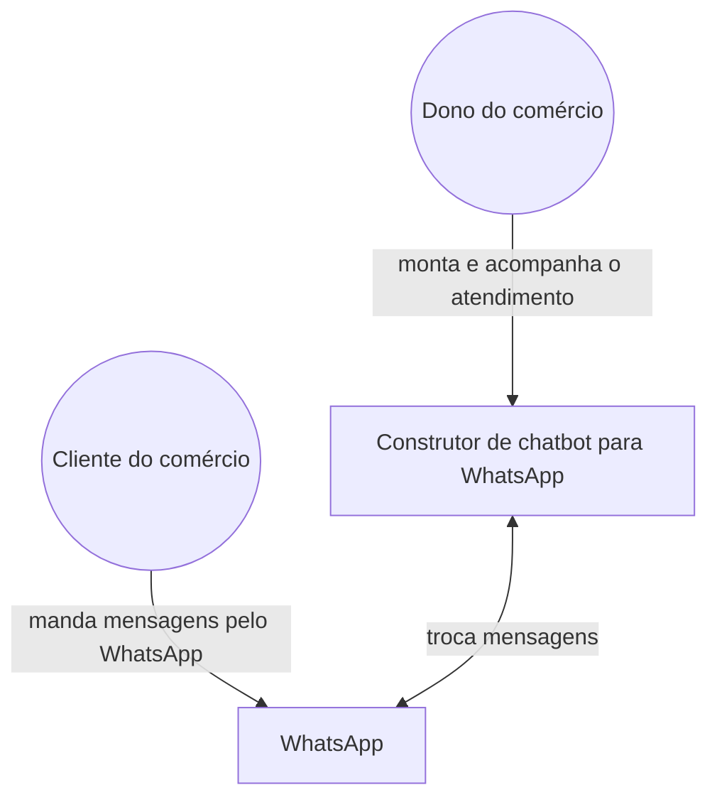
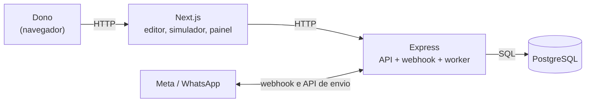
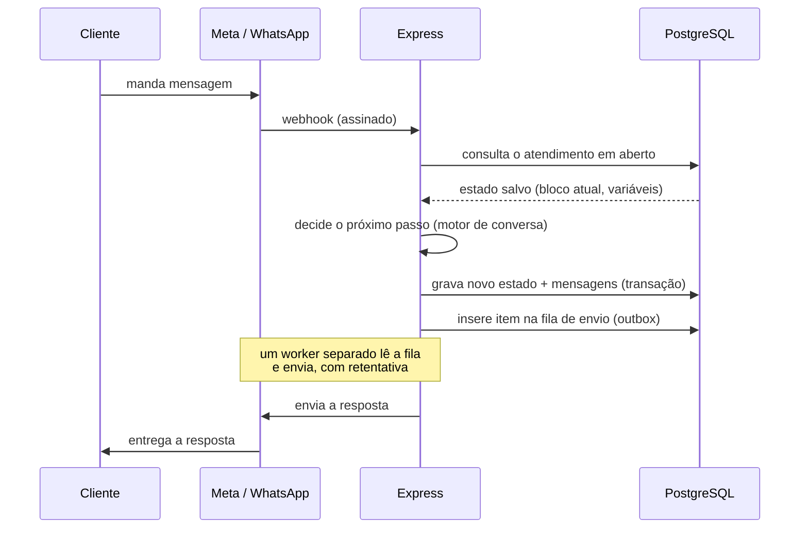

# Arquitetura

## Visão geral (nível de contexto)

O sistema permite que o dono de um pequeno comércio monte, sem
programar, um fluxo de atendimento automático (horários, preços,
dúvidas comuns), que funciona de verdade pelo WhatsApp dos clientes.

- **O dono** monta o fluxo e acompanha o atendimento.
- **O cliente** conversa com o bot pelo WhatsApp, sem saber que existe
  um sistema por trás.
- **O WhatsApp** é a única conexão externa: entrega mensagens ao
  cliente e repassa as que ele envia.

## As peças do sistema (nível de containers)

- **Next.js** — interface web: editor visual do fluxo, simulador de
  chat e painel de atendimentos.
- **Express** — API, recebedor de webhook do WhatsApp e worker da
  fila de envio (ADR-0006). É onde o motor de conversa roda.
- **PostgreSQL** — armazena tudo (ADR-0001).

Next.js e Express são dois processos separados, falando por HTTP, não
um só fazendo tudo (ver ADR-0006 para o porquê).

## Páginas do Next.js

- `login`, `cadastro` — acesso à conta.
- `editor` — canvas do fluxo e simulador lado a lado, para testar
  enquanto edita (H2). Acoplar o simulador ao editor significa que,
  se um dia for necessário um link de simulador isolado, essa lógica
  precisará ser extraída.
- `painel` — lista de atendimentos (WhatsApp e simulador juntos) e
  detalhe de cada um (H4).

Em código, cada container corresponde a uma pasta em `apps/`
(`apps/web` para o Next.js, `apps/api` para o Express).

## O fluxo mais importante: mensagem recebida pelo WhatsApp

A consulta, a gravação do estado e a inserção na fila acontecem na
mesma transação: se o Express cair no meio, nada fica gravado pela
metade, e a Meta reenvia o webhook.

## Autenticação entre Next.js e Express

A verificação de login acontece sempre no servidor do Next.js, antes
de qualquer página chegar ao navegador — ver ADR-0008 para a decisão
completa (JWT em cookie `httpOnly`, `secure`, `sameSite: lax`).

## Decisões relacionadas

ADR-0001 (banco único), ADR-0002 a 0005 (modelagem), ADR-0006
(Express separado do Next.js), ADR-0008 (autenticação). Ver
`docs/decisoes/`.